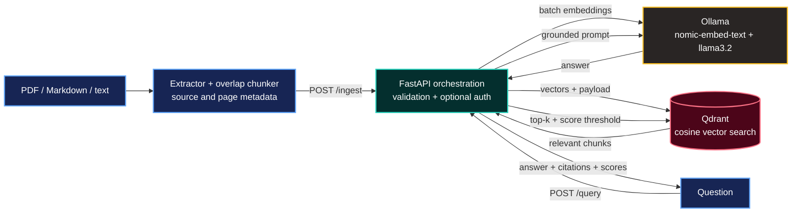

# Private RAG Stack — PDF Q&A with Citations

[](https://github.com/Rizwan-Riasat/rag-stack/actions/workflows/ci.yml)
[](https://www.python.org/)
[](https://fastapi.tiangolo.com/)
[](https://qdrant.tech/)
[](https://ollama.com/)

> A self-hosted retrieval-augmented generation system that ingests PDF, Markdown, and text documents, retrieves relevant passages with Qdrant, and produces grounded local answers through Ollama—with page-level sources and no external AI API.

## What makes this more than an LLM wrapper

- Local embedding and generation models; document contents are not sent to a hosted AI provider.
- PDF-aware ingestion preserves filename, page number, document identity, and chunk position.
- Deterministic chunk IDs prevent duplicate points when the same document is ingested again.
- A configurable similarity threshold refuses unsupported questions instead of forcing an answer.
- Answers include inline source references and structured retrieval evidence.
- Qdrant and Ollama remain private on the Docker network; the API binds to localhost.
- Optional constant-time API-key verification protects ingestion, query, and document-management routes.
- Health, readiness, tests, CI, and a transparent evaluation set make behavior observable.

## Architecture



See [docs/architecture.md](docs/architecture.md) for trust boundaries and request sequences.

## Quick start

Requirements: Docker Engine with Compose v2, roughly 4 GiB free RAM for the default model, and Python 3.10+ for the ingestion client.

```bash
git clone https://github.com/Rizwan-Riasat/rag-stack.git
cd rag-stack
cp .env.example .env
docker compose up -d --build

docker compose exec ollama ollama pull llama3.2:3b
docker compose exec ollama ollama pull nomic-embed-text
curl -fsS http://localhost:8000/ready
```

The default API is accessible only from the host at `http://127.0.0.1:8000`. Qdrant and Ollama have no host-published ports.

## Ingest a PDF

Install the small local PDF tool dependency, then ingest a document you are authorized to process:

```bash
python3 -m pip install -r requirements-tools.txt
python3 ingest_file.py ./example.pdf --dry-run
python3 ingest_file.py ./example.pdf
```

The ingester:

1. Extracts text page by page.
2. Creates paragraph-aware chunks with overlap.
3. Calculates a content-derived document ID.
4. Adds source, page, and chunk metadata.
5. Sends bounded batches to the API.

Scanned PDFs without a text layer are detected and reported as requiring OCR rather than silently ingesting empty pages.

## Ask a cited question

```bash
curl -sS http://localhost:8000/query \
  -H 'Content-Type: application/json' \
  -d '{"question":"What does the document say about backups?","top_k":4}'
```

Example response shape:

```json
{
  "answer": "The documented backup runs daily [SOURCE 1].",
  "grounded": true,
  "sources": [
    {
      "source": "example.pdf",
      "document_id": "example-a1b2c3d4e5f6a7b8",
      "page": 7,
      "chunk_index": 12,
      "score": 0.7821,
      "text": "..."
    }
  ]
}
```

If no chunk meets the threshold, the API returns `grounded: false`, no sources, and: `I don't know based on the indexed documents.`

## Manage indexed documents

```bash
curl -sS http://localhost:8000/documents
curl -X DELETE http://localhost:8000/documents/<document-id>
```

Legacy ingestion remains supported:

```bash
curl -X POST http://localhost:8000/ingest \
  -H 'Content-Type: application/json' \
  -d '{"texts":["Qdrant is the vector database used by this stack."]}'
```

## Optional API authentication

Generate a secret locally and place it in `.env`—never commit it:

```bash
openssl rand -hex 32
```

Set `RAG_API_KEY=<generated-value>`, recreate the API, and send `X-API-Key` on protected requests. `ingest_file.py` reads the value from the `RAG_API_KEY` environment variable. Health endpoints intentionally remain unauthenticated for container monitoring.

This lightweight mechanism is suitable for a private host. For internet exposure, use TLS, a proper identity-aware reverse proxy, rate limiting, and network controls; see [SECURITY.md](SECURITY.md).

## API surface

| Method | Path | Purpose | Protected when key set |
|---|---|---|---|
| `POST` | `/ingest` | Embed and upsert chunks | Yes |
| `POST` | `/query` | Retrieve and answer with sources | Yes |
| `GET` | `/documents` | Summarize indexed documents | Yes |
| `DELETE` | `/documents/{id}` | Delete every chunk for a document | Yes |
| `GET` | `/health` | API liveness | No |
| `GET` | `/ready` | Qdrant and Ollama readiness | No |
| `GET` | `/docs` | Interactive OpenAPI documentation | No |

## Quality controls

Run deterministic unit tests:

```bash
python3 -m pip install -r requirements-dev.txt
pytest -q
```

Run the live smoke evaluation after starting the stack:

```bash
python3 ingest_file.py eval/knowledge.md
python3 eval/run_eval.py
```

The included evaluation checks supported questions and an out-of-scope refusal. It is deliberately small and transparent—not presented as a production benchmark. Expand it with representative, non-sensitive domain questions before comparing models or retrieval settings. See [docs/evaluation.md](docs/evaluation.md).

## Reliability and security decisions

| Risk | Control |
|---|---|
| Hallucination from weak retrieval | Similarity cutoff plus explicit refusal path |
| Missing provenance | Source filename, page, chunk index, scores, and inline citations |
| Duplicate ingestion | Stable UUID derived from document/chunk identity and content |
| Unbounded requests | Pydantic limits for text, batches, questions, and `top_k` |
| Prompt injection in documents | Delimited source blocks and instruction/data separation |
| Exposed backing services | Qdrant/Ollama use `expose`, not host `ports` |
| Dependency drift | Exact Python, Qdrant, and Ollama versions |
| False-positive health | Separate liveness and dependency-aware readiness endpoints |
| Container privilege | Non-root API user, read-only filesystem, `no-new-privileges` |

Prompt injection defenses reduce risk but do not make arbitrary hostile documents safe. Treat uploaded documents as untrusted data and apply authorization outside this single-user reference stack.

## Repository map

```text
.
├── app/                    # FastAPI service and pinned runtime
├── docs/                   # Architecture, evaluation, and operations
├── eval/                   # Small transparent live evaluation set
├── tests/                  # Deterministic unit tests
├── .github/workflows/      # CI checks
├── docker-compose.yml      # Hardened local orchestration
├── ingest_file.py          # PDF/Markdown/text ingestion client
└── requirements-*.txt      # Tooling and development dependencies
```

## Current scope

This is a single-node, single-user reference implementation. It does not yet provide multi-tenancy, OCR, hybrid BM25/vector search, reranking, GPU scheduling, distributed workers, or production identity management. Those are explicit future extensions, not hidden limitations.

## Roadmap

- [ ] Terraform deployment to AWS EC2 with encrypted persistent volumes
- [ ] TLS reverse proxy, rate limiting, and identity-aware access
- [ ] OCR pipeline for scanned PDFs
- [ ] Hybrid retrieval and cross-encoder reranking
- [ ] Prometheus metrics, dashboards, and backup/restore automation
- [ ] Larger domain-specific evaluation suite and regression thresholds

## License

[MIT](LICENSE)
