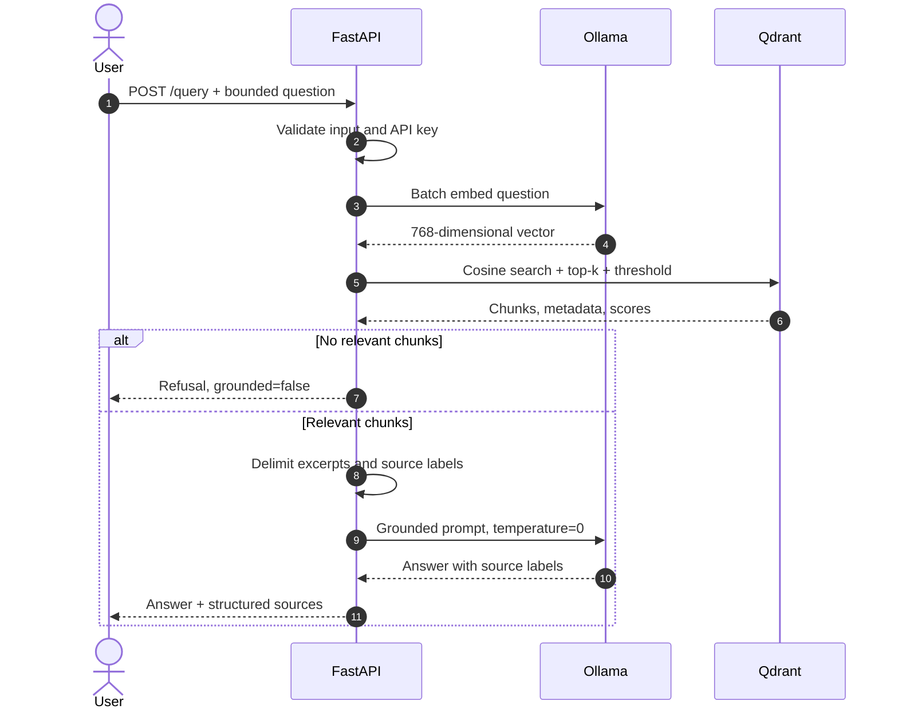
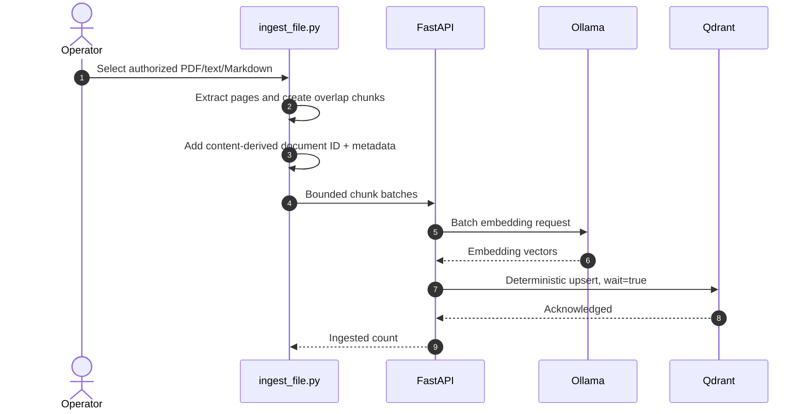

# Architecture and trust boundaries

## Query sequence

## Ingestion sequence

## Trust boundaries

| Boundary | Assumption | Control |
|---|---|---|
| Document → ingestion tool | Content may be malformed or hostile | Type checks, encrypted/empty PDF detection, bounded chunks |
| Client → API | Host clients are not automatically trusted | Localhost binding; optional API key; strict request limits |
| API → model | Retrieved text may contain instructions | Explicit data delimiters and grounding rules |
| API → Qdrant/Ollama | Backing services should not be public | Internal Compose network only |
| Host → internet | External access requires more controls | TLS/authenticated reverse proxy and firewall required |

## Persistence

Qdrant vectors/payloads and Ollama models use named Docker volumes. Removing containers does not delete them; `docker compose down -v` does. Back up `qdrant_data` before destructive maintenance when the index cannot be recreated cheaply.
